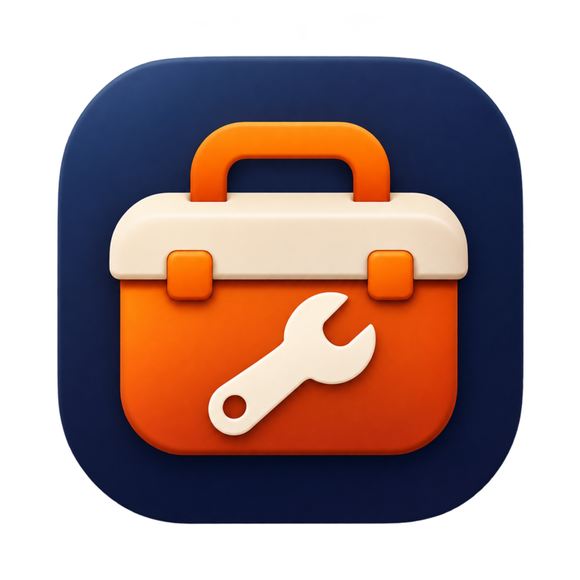

<p align="center">
  
</p>

<h1 align="center">DevUtils</h1>

<p align="center">
  Everyday developer tools in one fast, native macOS window.<br>
  Built in Rust with <a href="https://github.com/emilk/egui">egui</a>.
</p>

A native macOS app that gathers the small tools developers reach for every day — formatting JSON, decoding a JWT, testing a regex, converting a timestamp — in one fast window. Everything runs locally: nothing you paste ever leaves your machine.

## Tools

| Category | Tools |
|---|---|
| **Date & scheduling** | Unix Time Converter (calendar, time zones, relative time) · Cron Job Parser (description + next runs) |
| **Data conversion** | JSON Format/Validate (indent, sorted keys, tree view) · URL Parser (editable components and parameters) |
| **Network** | IP Subnet Calculator (IPv4 and IPv6 CIDR details, AWS usable and reserved addresses, split into subnets, overlap check for VPC peering) |
| **Encoding** | Base64 (text or files, URL-safe, hex dump of binary) · Base64 Image (drag & drop, data URIs) · URL Encode/Decode (component or full URL) · HTML Entities · Backslash Escape/Unescape · Hex ↔ ASCII |
| **Security & identifiers** | JWT Debugger (expiry status, HS256/384/512 verification) · UUID v4 / v7 and ULID (bulk, timestamps) · Hash Generator (MD5, SHA-1, SHA-256, SHA-512) · Password Generator (passwords and passphrases) · X.509 Certificate Decoder |
| **Text & generators** | RegExp Tester (highlighted matches, replace, common patterns) · QR Code Reader/Generator · String Inspector (hidden characters, line endings, Unicode names) · Case Converter (camel, snake, kebab, slug…) · Color Converter (picker, CSS formats, WCAG contrast) · Line Sort/Dedupe |
| **Compare** | Code Compare (side by side or unified, changed words highlighted, syntax highlighting, folded unchanged lines, copy as a patch) · Image Compare (swipe slider, side by side, onion skin, difference map with tolerance, zoom and pixel colors) |
| **Code & markup** | Number Base Converter · HTML, CSS/SCSS, JS and XML Beautify/Minify · SQL Formatter |

Most tools show the input on the left and the result on the right, and update **as you type**. Code is syntax-highlighted (JSON, SQL, JS, HTML, CSS, XML…), and every tool has buttons to paste from the clipboard, load a **Sample** and copy the result. Results shown as a list (hashes, color formats, dates, certificate fields…) have a copy button on each value. The **⇄ Reuse** menu sends a result back as input, or to another tool — e.g. decode Base64, then send the JSON to the formatter.

On the home screen, **press ⌘V to paste anything**: DevUtils recognizes JWTs, JSON, timestamps and dates, UUIDs and ULIDs, IP addresses and CIDR blocks, URLs, colors, cron expressions, certificates, Base64 and more, and opens the right tool with it. Dropping files works the same way — two images open in Image Compare, two text files in Code Compare. **⌘K** opens a palette to jump to any tool from anywhere.

Star the tools you use most (⌘D, the ☆ in the title bar, or right-click a tool): they appear first in the sidebar, on the home screen and in the palette. DevUtils remembers between launches the open tool, recent tools, favorites, the sidebar and the window's size and position, in `~/Library/Application Support/DevUtils/app.ron`. What you type in the tools is never saved, since it may contain tokens or secrets.

### Keyboard shortcuts

| Shortcut | Action |
|---|---|
| ⌘K | Open the palette: find a tool or a command |
| ⌘V (home screen) | Open the clipboard's content in the right tool |
| ⌘D | Add the open tool to the favorites, or remove it |
| ⌘1 | Show / hide the sidebar |
| ⌘⇧F | Filter the sidebar |

## Build and run

Requires macOS and a recent stable [Rust toolchain](https://rustup.rs).

```sh
cd app
cargo run                # start the app (debug build)
cargo test               # run the test suite
cargo build --release    # optimized binary: app/target/release/devutils
```

The release profile uses full link-time optimization for a smaller binary, so a release build takes a few minutes.

### Install as a macOS app

```sh
scripts/bundle-macos.sh             # builds dist/DevUtils.app and a release zip
scripts/bundle-macos.sh --install   # ...and copies DevUtils.app to /Applications
```

Release builds are also attached to the [GitHub releases](../../releases). The app is signed ad hoc, not notarized: after downloading it, allow it once with right-click → **Open**, or run `xattr -dr com.apple.quarantine /Applications/DevUtils.app`.

The interface uses the macOS system fonts (SF Pro, SF Mono), loaded from `/System/Library/Fonts` at startup. They are not bundled; on other systems egui's default fonts are used. Icons come from [Phosphor](https://phosphoricons.com) via `egui-phosphor`.

### Command-line options

| Option | Effect |
|---|---|
| `--tool "<name>"` | Open a tool directly, e.g. `--tool "JSON Format/Validate"` |
| `--sample` | With `--tool`, load the tool's example |
| `--palette` | Start with the ⌘K palette open |
| `--screenshot <file.png>` | Save a screenshot of the window and quit (handy to check the interface) |

```sh
cargo run -- --tool "SQL Formatter" --sample --screenshot /tmp/sql.png
```

## Project layout

```
app/
├── Cargo.toml
├── assets/app-icon.png
└── src/
    ├── main.rs          window, sidebar, title bar, home screen, ⌘K palette
    ├── ui.rs            color theme, fonts, icons, shared widgets, editors and highlighting
    └── tools/
        ├── mod.rs       Tool trait, TextTool helper, tool registry
        ├── detect.rs    recognizes pasted text (JWT, JSON, timestamp…) for ⌘V on the home screen
        ├── format/      beautify/minify (css.rs and html.rs are hand-written)
        └── *.rs         one file per tool or group of small tools
```

## Adding a tool

A tool that turns text into text only needs a function and one line in the registry:

```rust
// src/tools/text.rs
pub fn reverse() -> Box<dyn Tool> {
    Box::new(TextTool::new("Reverse Text", icon::ARROW_COUNTER_CLOCKWISE, Category::Text, vec![
        ("Reverse", |s| Ok(s.chars().rev().collect())),
    ])
    .describe("Reverses the characters of the input.")
    .sample("Hello, world!"))
}
```

```rust
// src/tools/mod.rs, in registry()
text::reverse(),
```

Each action returns `Result<String, String>`: the value goes to the output pane, an error is shown in a red banner. The first action is drawn as the primary button. The icon is any [Phosphor](https://phosphoricons.com) icon from `ui::icon`.

Optional builder methods:

| Method | Effect |
|---|---|
| `.describe("…")` | One-line explanation under the title |
| `.sample("…")` | Adds a Sample button that loads this input and runs the primary action |
| `.syntax("json")` | Highlights both panes (any syntect language name or extension: `sql`, `js`, `html`, `rs`…) |
| `.key_value_output()` | Shows `Key: value` results with muted keys |

For a tool with its own interface (options, previews, several inputs), implement the `Tool` trait on a struct that holds its state, and draw it with the helpers in `ui.rs` (`split`, `toolbar`, `code_editor`, `action_button`, `copy_button`…). `lines.rs` and `case.rs` are short examples.
