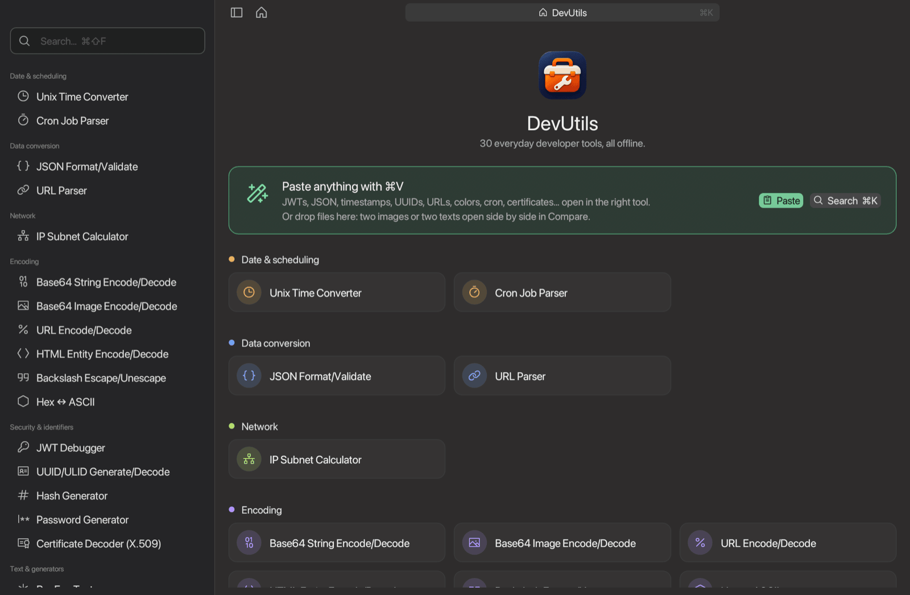
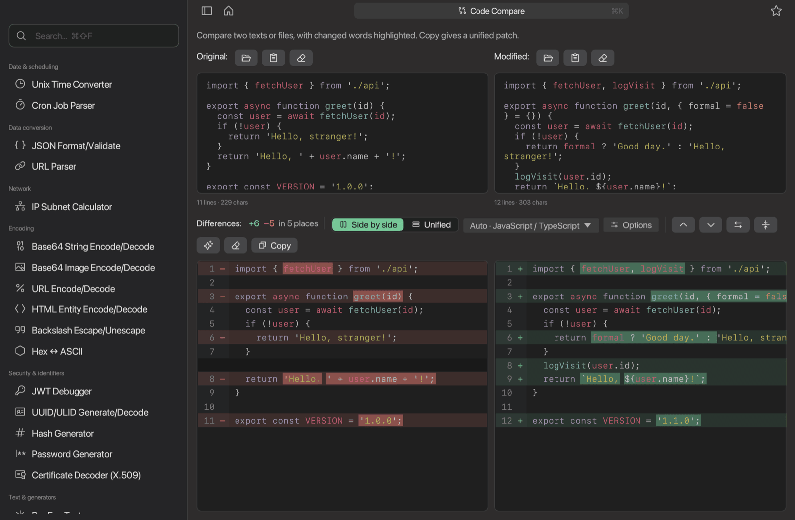
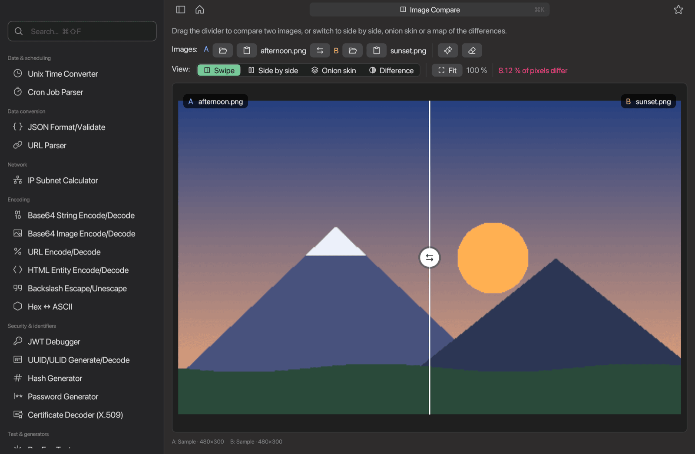
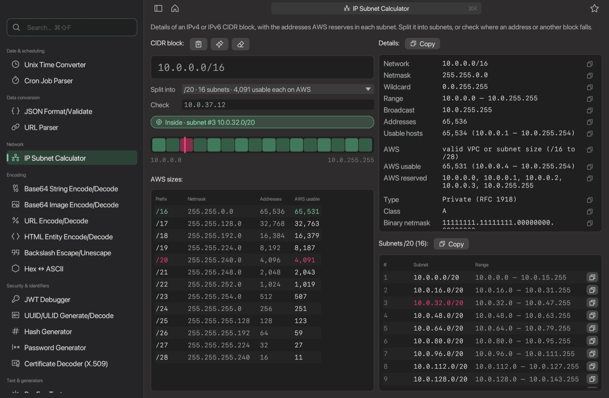
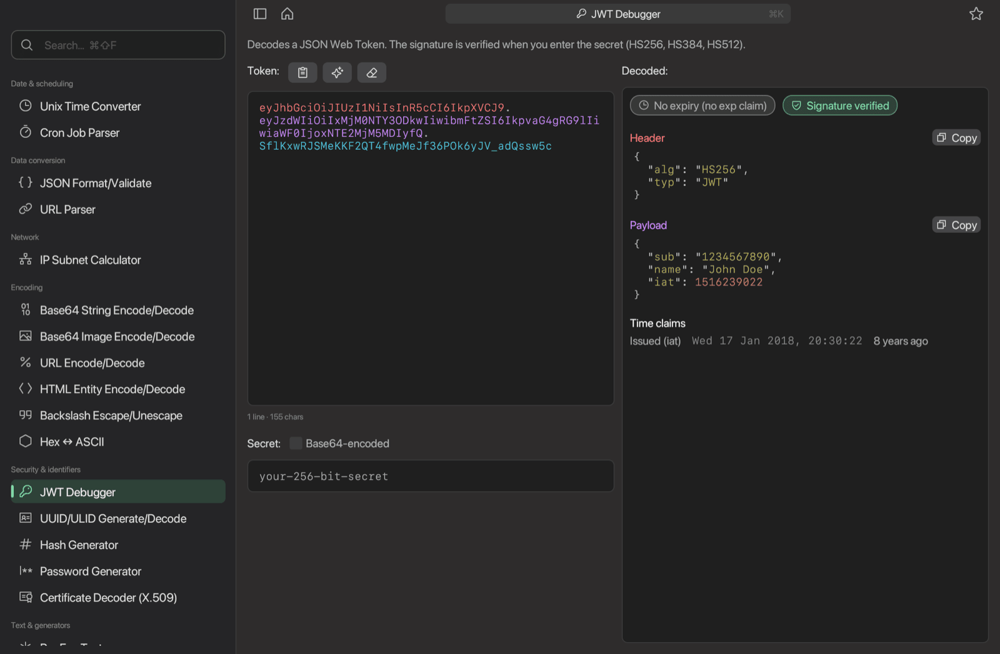
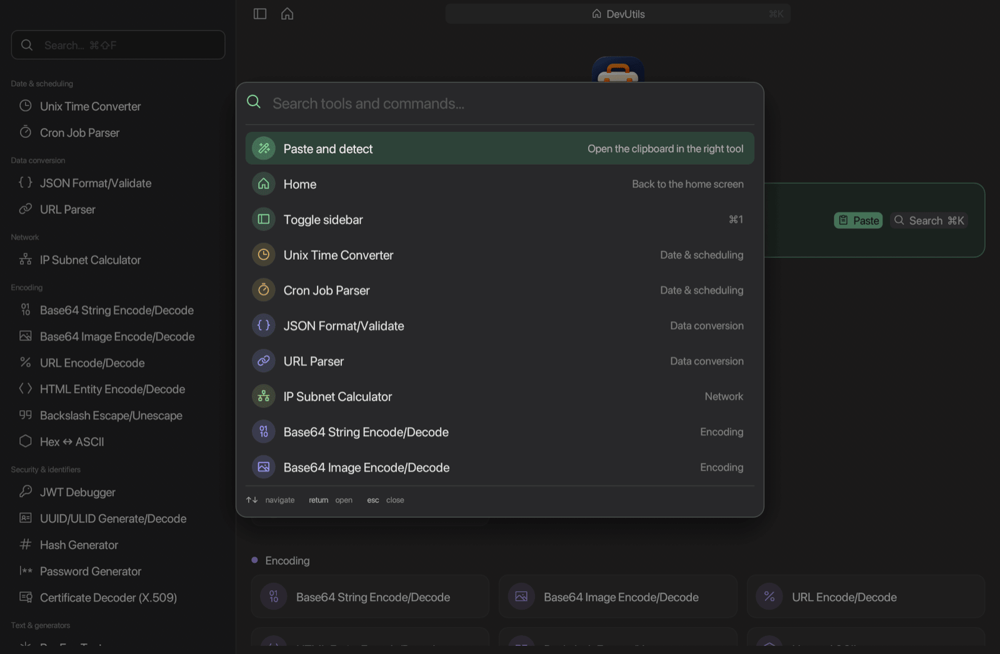
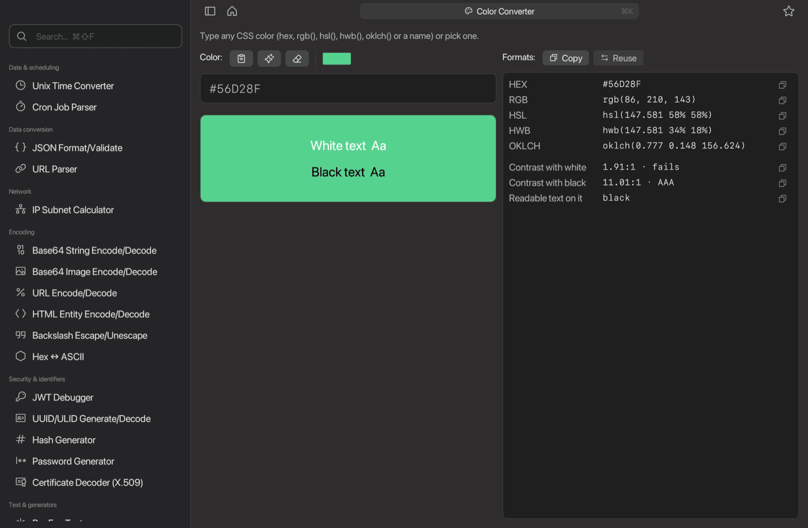

<p align="center">
  
</p>

<h1 align="center">DevUtils</h1>

<p align="center">
  30 everyday developer tools in one fast, native macOS window.<br>
  Built in Rust with <a href="https://github.com/emilk/egui">egui</a>. Everything runs offline.
</p>

<p align="center">
  <a href="../../releases/latest"><b>Download the latest release</b></a>
</p>

<p align="center">
  
</p>

DevUtils gathers the small tools developers reach for every day — formatting JSON, decoding a JWT, testing a regex, converting a timestamp, comparing two files, planning a VPC's subnets — in one window. Nothing you paste ever leaves your machine.

## Highlights

- **Paste anything.** Press ⌘V on the home screen: DevUtils recognizes JWTs, JSON, timestamps and dates, UUIDs and ULIDs, IP addresses and CIDR blocks, URLs, colors, cron expressions, certificates, Base64 and more, and opens the right tool with it. Drop files the same way: two images open in Image Compare, two texts in Code Compare.
- **Live results.** Tools update as you type, with syntax highlighting (JSON, SQL, JS, HTML, CSS, XML…). Results shown as a list — hashes, color formats, dates, certificate fields — have a copy button on each value.
- **Chain tools.** The **⇄ Reuse** menu sends a result back as input, or to another tool: decode Base64, then send the JSON to the formatter.
- **Find a tool fast.** ⌘K opens a palette with fuzzy search. Star the tools you use most with ⌘D: they come first in the sidebar, on the home screen and in the palette.
- **Picks up where you left off.** The open tool, recent tools, favorites, sidebar and window are remembered between launches. What you type in the tools is never saved, since it may contain tokens or secrets.

## Screenshots

<table>
  <tr>
    <td width="50%"><br><b>Code Compare</b> — side by side or unified, changed words highlighted</td>
    <td width="50%"><br><b>Image Compare</b> — drag the divider, or see the pixels that differ</td>
  </tr>
  <tr>
    <td><br><b>IP Subnet Calculator</b> — AWS-ready: reserved addresses, splits, overlap check</td>
    <td><br><b>JWT Debugger</b> — decoded claims, expiry and signature check</td>
  </tr>
  <tr>
    <td><br><b>⌘K palette</b> — jump to any tool or command</td>
    <td><br><b>Color Converter</b> — every CSS format, one copy button per value</td>
  </tr>
</table>

## Tools

### Date & scheduling

| Tool | What it does |
|---|---|
| **Unix Time Converter** | Timestamps in seconds, ms, µs or ns (detected automatically), ISO 8601 or RFC 2822 dates; calendar and clock fields, any IANA time zone, relative time ("3 days ago") |
| **Cron Job Parser** | A plain-English description of a cron expression (5 fields, or 6 with seconds) and its next runs |

### Data conversion

| Tool | What it does |
|---|---|
| **JSON Format/Validate** | Validates as you type; formats (2 or 4 spaces, tabs) or minifies, sorts keys, shows a collapsible tree; errors point at the line and column |
| **URL Parser** | Splits a URL into scheme, credentials, host, port, path, query parameters and fragment; edit any part and the URL is rebuilt |

### Network

| Tool | What it does |
|---|---|
| **IP Subnet Calculator** | IPv4 and IPv6 CIDR blocks: netmask, range, usable hosts, address type. For AWS: valid VPC/subnet sizes (/16 to /28), usable and reserved addresses. Splits a block into subnets, locates an address, and checks whether two blocks overlap (e.g. before peering two VPCs) |

### Encoding

| Tool | What it does |
|---|---|
| **Base64 String Encode/Decode** | Encodes text or a dropped file, decodes Base64 (URL-safe alphabet, line breaks and missing padding accepted); hex dump of binary results |
| **Base64 Image Encode/Decode** | Image ↔ data URI with a preview (PNG, JPEG, WebP, BMP); open, drop or paste |
| **URL Encode/Decode** | Component (`encodeURIComponent`) or full URL (`encodeURI`) encoding, and decoding |
| **HTML Entity Encode/Decode** | Encodes `& < > " '`; decodes every named entity (`&eacute;`, `&nbsp;`…) and numeric ones |
| **Backslash Escape/Unescape** | Escapes text for a string literal, or turns `\n`, `\t`, `\uXXXX`… back into characters |
| **Hex ↔ ASCII** | Text to hexadecimal bytes and back (spaces, colons, `0x` or `\x` prefixes accepted) |

### Security & identifiers

| Tool | What it does |
|---|---|
| **JWT Debugger** | Colored header, payload and signature; `exp`, `nbf` and `iat` as dates with a validity badge; HS256, HS384 and HS512 signature verification |
| **UUID/ULID Generate/Decode** | Generates UUID v4, UUID v7 or ULID, in bulk, uppercase or without hyphens; decodes identifiers, including the timestamp of v7 UUIDs and ULIDs |
| **Hash Generator** | MD5, SHA-1, SHA-256 and SHA-512 of the exact input |
| **Password Generator** | Passwords or passphrases from the system's secure random generator: length, character sets, look-alike filter, strength meter, several at once |
| **Certificate Decoder (X.509)** | PEM or Base64 DER certificates: subject, issuer, validity and status, alternative names, public key, signature algorithm, fingerprints |

### Text & generators

| Tool | What it does |
|---|---|
| **RegExp Tester** | Highlighted matches and groups, a replace preview (`$1`, `${name}`) and a menu of common patterns |
| **QR Code Reader/Generator** | A QR code from any text; reads one from a copied image, an image file or a dropped image |
| **String Inspector** | Highlights hidden characters (non-breaking and zero-width spaces, BOM, direction controls); line endings; counts in characters, code points, UTF-8 bytes and UTF-16 units; a per-character Unicode table |
| **String Case Converter** | camelCase, PascalCase, snake_case, CONSTANT_CASE, kebab-case, slug, dot.case, path/case, Title Case, Sentence case… each with its own copy button |
| **Color Converter** | Any CSS color or name, or the color picker: HEX, RGB, HSL, HWB, OKLCH and WCAG contrast against black and white |
| **Line Sort/Dedupe** | Sorts and removes duplicate lines, ignoring case or surrounding whitespace if you like |

### Compare

| Tool | What it does |
|---|---|
| **Code Compare** | Two texts or files side by side or unified, with line numbers, syntax highlighting, changed words highlighted and similar lines aligned; folds unchanged lines, ignores whitespace or case on request, copies the result as a unified patch |
| **Image Compare** | Swipe slider, side by side, onion skin, or a map of the differing pixels (with a tolerance for compression noise); zoom, pan and the colors under the pointer |

### Code & markup

| Tool | What it does |
|---|---|
| **Number Base Converter** | Decimal, hexadecimal, octal and binary (`0x`, `0o`, `0b` prefixes, underscores and negative numbers accepted) |
| **HTML Beautify/Minify** | Indents HTML one element per line, inline `<style>` and `<script>` included, or minifies it |
| **CSS/SCSS Beautify/Minify** | Formats or minifies CSS and SCSS (nesting, `//` comments and `#{…}` interpolation understood) |
| **JS Beautify/Minify** | Reprints JavaScript (JSX allowed); minifying also shortens names |
| **XML Beautify/Minify** | Indents or minifies XML; well-formedness is checked, comments and CDATA are kept |
| **SQL Formatter** | One clause per line with uppercase keywords |

### Keyboard shortcuts

| Shortcut | Action |
|---|---|
| ⌘K | Open the palette: find a tool or a command |
| ⌘V (home screen) | Open the clipboard's content in the right tool |
| ⌘D | Add the open tool to the favorites, or remove it |
| ⌘1 | Show / hide the sidebar |
| ⌘⇧F | Filter the sidebar |

## Install

Download `DevUtils-<version>-macos-arm64.zip` from the [latest release](../../releases/latest), unzip it and move **DevUtils.app** to your Applications folder. Requires macOS 11 or later on Apple Silicon.

The app is signed ad hoc, not notarized, so macOS blocks the first launch of a downloaded copy: right-click the app → **Open** → **Open**, or run `xattr -dr com.apple.quarantine /Applications/DevUtils.app`.

DevUtils saves its state (open tool, recent tools, favorites, sidebar, window) in `~/Library/Application Support/DevUtils/app.ron`.

## Build and run

Requires macOS and a recent stable [Rust toolchain](https://rustup.rs).

```sh
cd app
cargo run                # start the app (debug build)
cargo test               # run the test suite
cargo build --release    # optimized binary: app/target/release/devutils
```

The release profile uses full link-time optimization for a smaller binary, so a release build takes a few minutes.

To build the app bundle yourself:

```sh
scripts/bundle-macos.sh             # builds dist/DevUtils.app and a release zip
scripts/bundle-macos.sh --install   # ...and copies DevUtils.app to /Applications
```

The interface uses the macOS system fonts (SF Pro, SF Mono), loaded from `/System/Library/Fonts` at startup. They are not bundled; on other systems egui's default fonts are used. Icons come from [Phosphor](https://phosphoricons.com) via `egui-phosphor`.

### Command-line options

| Option | Effect |
|---|---|
| `--tool "<name>"` | Open a tool directly, e.g. `--tool "JSON Format/Validate"` |
| `--sample` | With `--tool`, load the tool's example |
| `--palette` | Start with the ⌘K palette open |
| `--screenshot <file.png>` | Save a screenshot of the window and quit (handy to check the interface). Starts from a clean state and saves nothing |

```sh
cargo run -- --tool "SQL Formatter" --sample --screenshot /tmp/sql.png
```

The screenshots in `docs/screenshots` were taken this way.

## Project layout

```
app/
├── Cargo.toml
├── assets/app-icon.png
└── src/
    ├── main.rs          window, sidebar, title bar, home screen, ⌘K palette, saved state
    ├── ui.rs            color theme, fonts, icons, shared widgets, editors and highlighting
    └── tools/
        ├── mod.rs       Tool trait, TextTool helper, tool registry
        ├── detect.rs    recognizes pasted text (JWT, JSON, timestamp…) for ⌘V on the home screen
        ├── format/      beautify/minify (css.rs and html.rs are hand-written)
        └── *.rs         one file per tool or group of small tools
docs/screenshots/        images used in this README
scripts/bundle-macos.sh  builds the .app bundle and the release zip
```

## Adding a tool

A tool that turns text into text only needs a function and one line in the registry:

```rust
// src/tools/text.rs
pub fn reverse() -> Box<dyn Tool> {
    Box::new(TextTool::new("Reverse Text", icon::ARROW_COUNTER_CLOCKWISE, Category::Text, vec![
        ("Reverse", |s| Ok(s.chars().rev().collect())),
    ])
    .describe("Reverses the characters of the input.")
    .sample("Hello, world!"))
}
```

```rust
// src/tools/mod.rs, in registry()
text::reverse(),
```

Each action returns `Result<String, String>`: the value goes to the output pane, an error is shown in a red banner. The result updates as you type. With several actions, a segmented control switches between them (the first one is selected at first). The icon is any [Phosphor](https://phosphoricons.com) icon from `ui::icon`.

Optional builder methods:

| Method | Effect |
|---|---|
| `.describe("…")` | One-line explanation under the title |
| `.sample("…")` | Adds a Sample button that loads this input and runs the first action |
| `.syntax("json")` | Highlights both panes (any syntect language name or extension: `sql`, `js`, `html`, `rs`…) |
| `.key_value_output()` | Shows `Key: value` results as a list, with a copy button on each value |

For a tool with its own interface (options, previews, several inputs), implement the `Tool` trait on a struct that holds its state, and draw it with the helpers in `ui.rs` (`split`, `toolbar`, `code_editor`, `properties`, `segmented`, `copy_button`…). `lines.rs` and `case.rs` are short examples.
